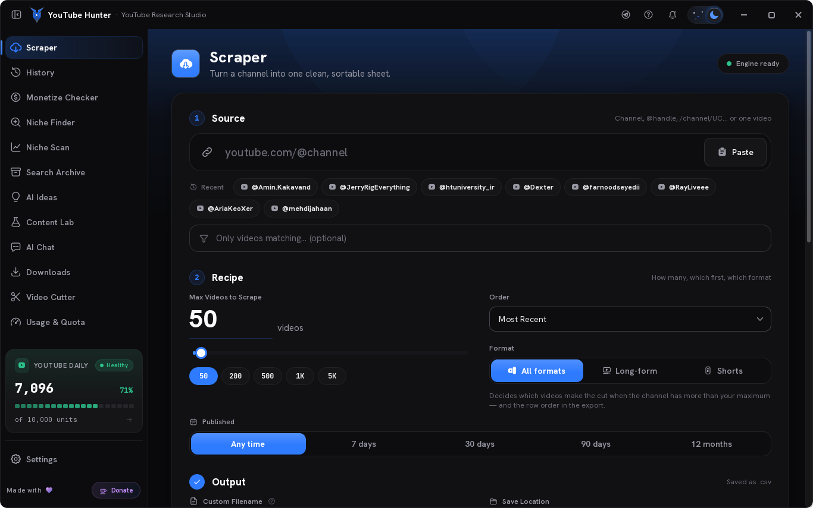
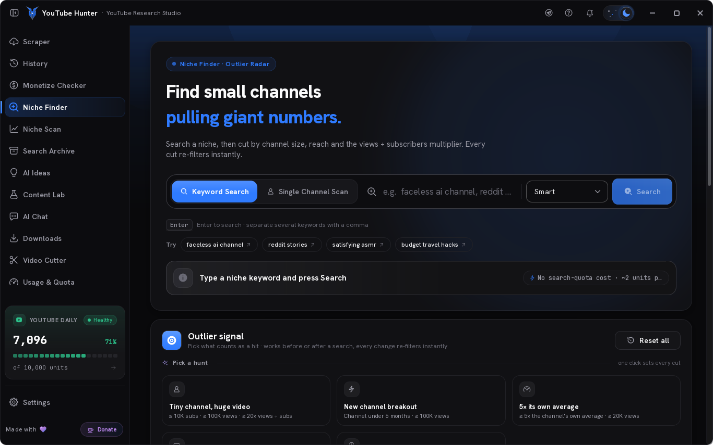
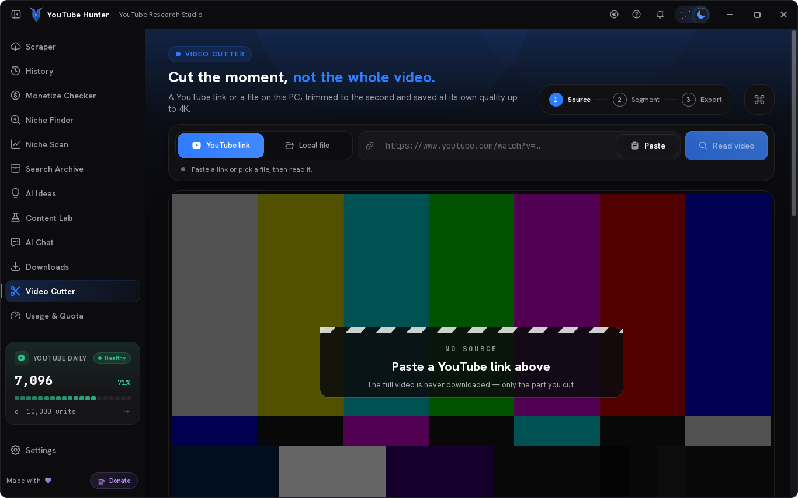
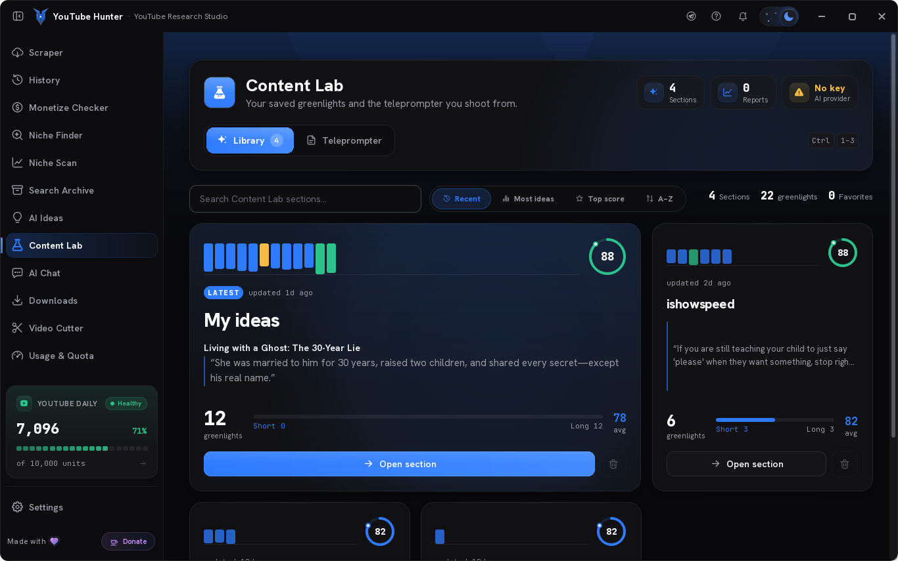
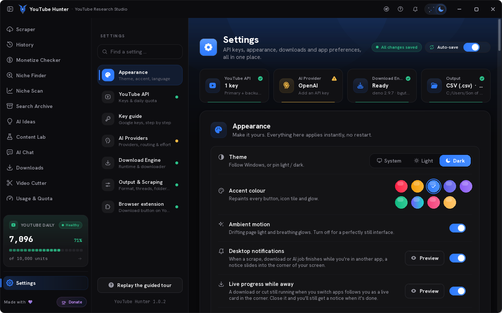
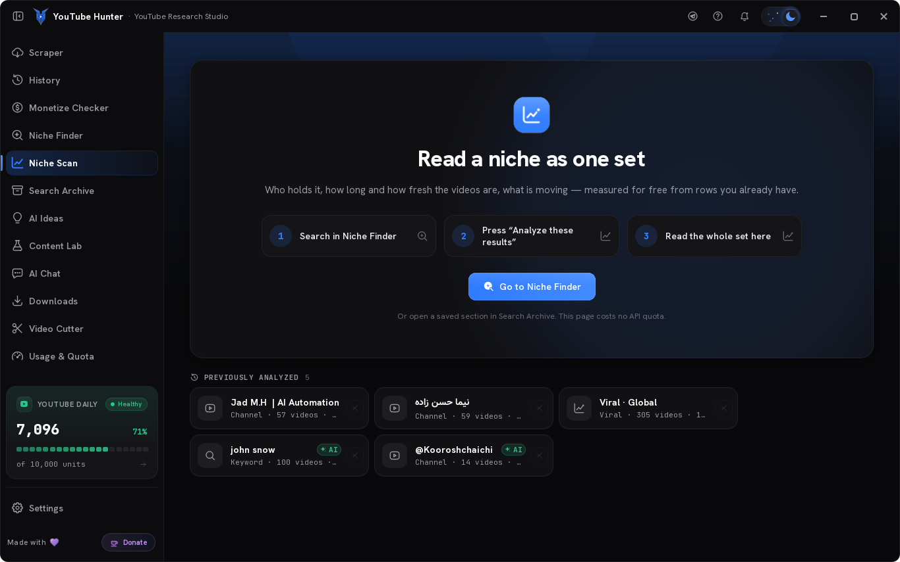

<a id="english"></a>
<div align="center">


# YouTube Hunter

**Language:** **English** · [فارسی](#persian)

**YouTube research, outlier detection, downloads and clip cutting — one Windows desktop app, plus a button inside YouTube itself.**

[Install](docs/INSTALL.md) · [Browser extension](docs/EXTENSION.md) · [Build from source](#build-from-source) · [Changelog](CHANGELOG.md)


-0ea5e9?style=flat-square)


</div>

---

YouTube Hunter is a desktop workspace for people who run YouTube channels. Point it at a channel or a keyword: it pulls the data, finds the videos that **over-perform** their own channel, turns the winners into a content blueprint, downloads what you need at the quality you want, and cuts the clips — without a browser full of tabs and a spreadsheet.

It is a native Windows application (Python + Qt Quick/QML). Everything runs on your machine: your API key, your downloads, your archive. A companion **Chrome/Edge extension** puts the same download and cut panel on the YouTube page itself, and the desktop app does the work in the background.

<div align="center">

</div>

## Download & install

1. Open the **[latest release](../../releases/latest)** and download **`YouTubeHunter-Setup-1.0.2-x64.exe`**.
2. Run it. It installs **per user** in `%LOCALAPPDATA%\Programs\YouTube Hunter` — no administrator prompt, no UAC, nothing written to `Program Files`.
3. Launch **YouTube Hunter** from the Start menu or the desktop shortcut.

No Python, no pip, no Visual C++ redistributable and no internet connection is needed to install or start the app: the whole runtime ships inside the installer (~235 MB), including the JavaScript runtime, the PO Token helper and the embedded browser the Support window uses.

> **SmartScreen:** the installer is not code-signed, so Windows may show *"Windows protected your PC"* the first time. Choose **More info → Run anyway**. A code-signing certificate is the only way to remove that prompt.

Full walkthrough, first-run setup and troubleshooting: **[docs/INSTALL.md](docs/INSTALL.md)**.

### First run

The app opens on the **Scraper**. To use the YouTube-powered features you need a **YouTube Data API v3 key** (free from [Google Cloud Console](https://console.cloud.google.com/apis/library/youtube.googleapis.com)) — paste it in **Settings → API**. AI features are optional: add a provider (Google Gemini, OpenAI, or any OpenAI-compatible endpoint) in **Settings → AI Providers**.

Everything is stored locally: `%APPDATA%\YoutubeScrapperCyber\` holds your config, API keys and the SQLite archive. Uninstalling deliberately leaves it alone.

## The Hunter button (browser extension)


A Chrome/Edge extension (Manifest V3) adds a **Hunter** button next to Like/Share on any YouTube watch page and in Shorts:

- **Download** — real qualities with real sizes, video format (MP4 / MKV / WEBM), audio format (MP3 / M4A / OPUS / WAV / FLAC), and the **audio track** (original or any dub). The selected row turns into a live capsule: percent, speed, size, ETA, pause/resume, and Play / Show in folder when it finishes.
- **Cut** — mark In / Out on a zoomed ruler (or type a timecode), pick a quality or audio-only output, and only that clip is downloaded and cut. Progress is live; the clip lands in the app's Cutter history with its own card.
- **Follows you** — close the panel or switch tabs and the desktop **live activity card** takes over until the job finishes.
- **Starts the app for you** — if the desktop app isn't running, clicking Hunter launches it through the `youtubehunter://` protocol (registered by the installer), minimised.

The extension talks to the app over a local JSON server on `127.0.0.1:47391`. Only requests carrying the extension origin **and** the `X-YTH-Bridge` header are accepted, so no website can start a download. Set `"browser_bridge": false` in the config to turn the bridge off entirely.

Step-by-step install (30 seconds): **[docs/EXTENSION.md](docs/EXTENSION.md)**.

## Features

### Research

| | |
|---|---|
| **Channel & keyword scraper** | Pulls a channel's catalogue or a search query, with quota-aware pacing, sorting and continuation. Depth is adjustable — a quick look or a full sweep. |
| **Outlier detection** | Scores every video against the channel's own baseline, so the 3×–30× videos surface instead of the ones with the most views. |
| **Niche Finder** | Searches a topic across channels, widens the query automatically when a filter would return nothing, and ranks the channels worth studying. |
| **Search Archive** | Every scrape is stored locally in SQLite — revisit, filter, sort and re-analyse without spending quota again. Cards paint only near the viewport, a cold open shows a skeleton instead of a black grid, and thumbnails land as one batch. |
| **Snapshot Insights** | A channel brief: cadence, formats, length, title patterns, what the outliers have in common — plus a saved **Brief (Dossier)** view with confidence bands, intent, signals and experiments. |

### Creation

| | |
|---|---|
| **AI Ideas** | Turns an outlier into concrete video ideas with hooks and angles, using your own model provider. |
| **Content Lab** | Builds a four-part blueprint (hook → structure → beats → CTA). |
| **AI Chat** | A chat panel wired to the data you already scraped: analyse a saved brief, drop in up to 50 links at once, ask about a channel, a niche or a single video. |
| **Monetization checker** | Estimates whether a niche or channel is worth the effort before you commit to it. |

### Production

| | |
|---|---|
| **Downloads** | Quality presets, audio-only, subtitles, thumbnails, container and audio-format choice, **audio-track / dub selection**, pause & resume, and a client-ladder retry chain with optional browser cookies for YouTube's per-client throttling. |
| **Video Cutter** | Frame-accurate cutting with a live preview, stream-copy for speed or re-encode for exactness, output as video (MP4/MKV/WEBM) or audio (MP3/M4A/OPUS/WAV/FLAC), local files too, and drag the result straight out to Explorer, Premiere or Telegram. |
| **Transcripts** | Two extraction engines (library + yt-dlp fallback) with proxy/cookie support, for scripting and AI analysis. |
| **Live activity cards** | Start a download or a cut, switch to another app — a card in the corner of the screen keeps showing progress, speed and ETA, then turns green when it lands. |
| **Connection guard** | Checks that YouTube is actually reachable (not just that the internet works), re-tests every minute, and reopens the gate the moment a VPN drops — downloads never half-fail silently. |

### The app itself

- **English interface**, dark and light themes, five accent colours, all remembered per user.
- **Per-user install, no admin rights, no Python required** — the installer carries the whole runtime.
- **Everything local** — config, archive and downloads stay on your machine; API keys are entered in Settings and never leave it.

## Screenshots

| Niche Finder | Video Cutter |
|---|---|
|  |  |

| Content Lab | Settings |
|---|---|
|  |  |

| Niche Scan | Scraper |
|---|---|
|  |  |

## Supported Windows

| | |
|---|---|
| **Windows 11** | ✅ 64-bit, all editions |
| **Windows 10** | ✅ 64-bit, **version 1809 (build 17763) or newer** |
| **Windows 8.1 / 7** | ❌ not supported (the bundled Qt 6 runtime requires Windows 10 1809+) |
| **32-bit Windows** | ❌ not supported — the build is x64-only |
| **Windows on ARM** | ⚠️ runs under x64 emulation, untested |
| **macOS / Linux** | ❌ the app is Windows-only (uses Win32 APIs for the frameless window, taskbar and notifications) |

## Build from source

Requirements: **Python 3.11+ (64-bit)** on Windows, and [Inno Setup 6](https://jrsoftware.org/isdl.php) if you want the installer.

```bat
git clone https://github.com/reyzodev/youtube-hunter.git
cd youtube-hunter
build.bat
```

`build.bat` creates an isolated `.build-venv`, installs the pinned dependencies, verifies every build input, runs PyInstaller with `YoutubeScrapper.spec`, verifies the output, and then compiles `installer.iss`:

```
dist\YouTubeHunter\YouTubeHunter.exe     the app (onedir — ship the whole folder)
Output\YouTubeHunter-Setup.exe           the installer
```

Three binaries are **not** in this repository because of their size, and `build.bat` stops and tells you if they are missing:

| File | Size | Why it is needed |
|---|---|---|
| `assets/bin/ffprobe.exe` | ~145 MB | mp3/audio-only downloads, the cutter's local-file probe, quality probing |
| `assets/bin/deno.exe` | ~93 MB | the JavaScript runtime yt-dlp needs to solve YouTube's download challenge |
| `assets/bin/bgutil-pot.exe` | ~45 MB | the PO Token helper — a **required** part of the download engine; without it YouTube serves a 360p-only list or 403 on VPN/datacenter IPs. GPL-3.0, bundled unmodified as a separate program (see `assets/bin/bgutil-pot-NOTICE.txt`) |

Run it without building:

```bat
python -m venv .venv
.venv\Scripts\pip install -r requirements.txt
.venv\Scripts\python main_qml.py
```

## Project layout

```
main_qml.py               entry point — builds the bridges, loads QML
app/
  qml/                    the interface: Main.qml + pages/ + components/
  qml_backend/            the ViewModels the QML talks to (incl. web_bridge for the extension)
  core/                   the actual logic: YouTube API, niche search, cutter, AI, downloads
  ui/                     icons, fonts, theme helpers
browser-extension/        the Hunter button (Manifest V3: content.js, panel.css, background.js)
fonts/                    bundled fonts
assets/                   icons, logo, installer icon (bin/ is not committed)
docs/                     install, extension, build notes, release notes
screenshots/              current UI
tools/                    developer lints (hover-flicker checker, icon art)
YoutubeScrapper.spec      PyInstaller recipe (also trims ~75 MB of unused Qt)
installer.iss             Inno Setup script (bundles the app, the extension, the URL protocol)
```

## Tech stack

| Layer | What |
|---|---|
| UI | Qt Quick / QML (Qt 6.12), PySide6, custom design tokens, no web views |
| Logic | Python 3.13, SQLite (local archive), `yt-dlp`, FFmpeg |
| APIs | YouTube Data API v3, `youtube-transcript-api`, Google Gemini / OpenAI-compatible providers |
| Extension | Chrome/Edge Manifest V3, vanilla JS + CSS, local JSON bridge on `127.0.0.1:47391` |
| Packaging | PyInstaller (onedir) + Inno Setup (per-user install) |

## Docs

- [`docs/INSTALL.md`](docs/INSTALL.md) — install, first run, extension setup, troubleshooting
- [`docs/EXTENSION.md`](docs/EXTENSION.md) — the Hunter button, end to end
- [`docs/BUILD.md`](docs/BUILD.md) — build and packaging notes
- [`docs/UPDATES.md`](docs/UPDATES.md) — how the in-app updater works and how to publish a release
- [`CHANGELOG.md`](CHANGELOG.md) — release notes

## Version

**1.0.2** — Content Lab blueprints build only what is on screen: the cover and the open act are built for the first paint and the other acts arm one per idle beat, so the first blueprint is ready in ~1 s instead of 2.4–3.6 s and switching ideas settles in ~0.2–0.9 s. The icon set is redrawn (Aurora Pro); both video grids scroll on a glide wheel and hover returns the moment you aim; the download picker switches format instantly; Niche Finder leads with goal recipes ("Pick a hunt") plus Fine-tune; AI Ideas greenlight follows schema v10 "Masterplan". The Scraper fires a desktop notification when YouTube blocks the IP and shows the block as a glass card. The Monetize Checker prices RPM on the audience and follows the real Partner Program; the notification bell fills on click; settings save in the background; My channel is a channel ID card (Format, Channel, Stage, Voice, Limits); and AI Chat re-renders long answers more calmly.

## License

Proprietary — © 2026 YouTube Hunter. All rights reserved.
This repository is published for reference, distribution and support of the app. Redistribution of the compiled application, or of modified versions of it, requires written permission.

Bundled third-party components keep their own licences: `bgutil-pot` is GPL-3.0 (see `assets/bin/bgutil-pot-NOTICE.txt`), and FFmpeg / deno / PySide6 / Qt are distributed under their respective licences inside the installer.

---

<a id="persian"></a>

## فارسی

YouTube Hunter یک فضای کار دسکتاپ برای افرادی است که کانال یوتیوب اداره می‌کنند. یک کانال یا یک کلیدواژه به آن بدهید: داده‌ها را می‌گیرد، ویدیوهایی را پیدا می‌کند که نسبت به عملکرد معمول همان کانال **بیش‌ازحد خوب** عمل کرده‌اند، برنده‌ها را به یک نقشه راه محتوایی تبدیل می‌کند، هرچه لازم دارید را با کیفیت دلخواه دانلود می‌کند و کلیپ‌ها را برش می‌دهد — بدون ده‌ها تب باز مرورگر و یک فایل اکسل.

این یک اپلیکیشن بومی ویندوز است (Python + Qt Quick/QML). همه‌چیز روی سیستم خودتان اجرا می‌شود: کلید API، دانلودها و آرشیو شما. یک **افزونه Chrome/Edge** همراه آن، همان پنل دانلود و برش را روی صفحه یوتیوب قرار می‌دهد و اپلیکیشن دسکتاپ کار را در پس‌زمینه انجام می‌دهد.

<div align="center">

</div>

## دانلود و نصب

1. **[آخرین نسخه](../../releases/latest)** را باز کنید و **`YouTubeHunter-Setup-1.0.2-x64.exe`** را دانلود کنید.
2. آن را اجرا کنید. نصب **برای هر کاربر** در `%LOCALAPPDATA%\Programs\YouTube Hunter` انجام می‌شود — بدون درخواست مدیر، بدون UAC و بدون نوشتن چیزی در `Program Files`.
3. **YouTube Hunter** را از منوی Start یا میانبر دسکتاپ اجرا کنید.

برای نصب یا اجرای برنامه به Python، pip، Visual C++ Redistributable یا اتصال اینترنت نیازی نیست: تمام محیط اجرا داخل نصب‌کننده است (حدود ۲۳۵ مگابایت)، شامل محیط اجرای JavaScript، کمک‌کننده PO Token و مرورگر تعبیه‌شده‌ای که پنجره Support از آن استفاده می‌کند.

> **SmartScreen:** نصب‌کننده امضای دیجیتال ندارد، بنابراین ویندوز ممکن است بار اول پیام *«Windows protected your PC»* را نشان دهد. گزینه **More info → Run anyway** را انتخاب کنید. تنها راه حذف این هشدار، یک گواهی code-signing است.

راهنمای کامل نصب، تنظیمات اولین اجرا و رفع اشکال: **[docs/INSTALL.md](docs/INSTALL.md)**.

### اولین اجرا

برنامه روی صفحه **Scraper** باز می‌شود. برای استفاده از قابلیت‌های مبتنی بر یوتیوب به یک **کلید YouTube Data API v3** نیاز دارید (رایگان از [Google Cloud Console](https://console.cloud.google.com/apis/library/youtube.googleapis.com)) — آن را در **Settings → API** وارد کنید. قابلیت‌های هوش مصنوعی اختیاری هستند: یک ارائه‌دهنده (Google Gemini، OpenAI یا هر endpoint سازگار با OpenAI) را در **Settings → AI Providers** اضافه کنید.

همه‌چیز محلی ذخیره می‌شود: `%APPDATA%\YoutubeScrapperCyber\` شامل تنظیمات، کلیدهای API و آرشیو SQLite است. حذف برنامه عمداً این پوشه را دست‌نخورده باقی می‌گذارد.

## دکمه Hunter (افزونه مرورگر)


یک افزونه Chrome/Edge (Manifest V3) دکمه **Hunter** را کنار Like/Share در هر صفحه تماشای یوتیوب و در Shorts اضافه می‌کند:

- **Download** — کیفیت‌های واقعی با حجم واقعی، انتخاب فرمت ویدیو (MP4 / MKV / WEBM)، فرمت صدا (MP3 / M4A / OPUS / WAV / FLAC) و **انتخاب صدا** (اصلی یا هر دوبله). ردیف انتخاب‌شده به یک کپسول زنده تبدیل می‌شود: درصد، سرعت، حجم، زمان باقی‌مانده، توقف/ادامه و Play / Show in folder پس از پایان.
- **Cut** — با یک خط‌کش بزرگ‌نمایی‌شده نقطه In / Out را مشخص کنید (یا timecode را تایپ کنید)، کیفیت یا خروجی صوتی را انتخاب کنید و فقط همان کلیپ دانلود و برش داده می‌شود. پیشرفت زنده است؛ کلیپ با کارت مخصوص خودش در تاریخچه Cutter برنامه ذخیره می‌شود.
- **همراه شما می‌آید** — پنل را ببندید یا تب را عوض کنید؛ **کارت فعالیت زنده** دسکتاپ تا پایان کار نمایش پیشرفت را ادامه می‌دهد.
- **خودش برنامه را اجرا می‌کند** — اگر اپلیکیشن دسکتاپ در حال اجرا نباشد، با کلیک روی Hunter از طریق پروتکل `youtubehunter://` (که نصب‌کننده ثبت می‌کند) و به‌صورت کوچک‌شده اجرا می‌شود.

افزونه از طریق یک سرور JSON محلی روی `127.0.0.1:47391` با برنامه ارتباط می‌گیرد. فقط درخواست‌هایی پذیرفته می‌شوند که هم origin افزونه و هم هدر `X-YTH-Bridge` را داشته باشند؛ بنابراین هیچ وب‌سایتی نمی‌تواند دانلود را شروع کند. برای خاموش کردن کامل این پل، `"browser_bridge": false` را در تنظیمات قرار دهید.

راهنمای قدم‌به‌قدم نصب (۳۰ ثانیه): **[docs/EXTENSION.md](docs/EXTENSION.md)**.

## قابلیت‌ها

### تحقیق و پژوهش

| | |
|---|---|
| **Channel & keyword scraper** | کاتالوگ یک کانال یا یک جست‌وجو را با گام‌بندی آگاه از سهمیه API، مرتب‌سازی و ادامه‌دهی می‌گیرد. عمق جست‌وجو قابل تنظیم است — یک نگاه سریع یا جست‌وجوی کامل. |
| **تشخیص ویدیوهای پرراندمان (Outlier)** | هر ویدیو را با خط پایه همان کانال مقایسه می‌کند تا ویدیوهای ۳ تا ۳۰ برابری دیده شوند، نه فقط ویدیوهایی که بیشترین بازدید مطلق را دارند. |
| **Niche Finder** | یک موضوع را در کانال‌های مختلف جست‌وجو می‌کند، وقتی فیلتری نتیجه‌ای برنمی‌گرداند جست‌وجو را خودکار گسترش می‌دهد و کانال‌های ارزشمند برای بررسی را رتبه‌بندی می‌کند. |
| **Search Archive** | هر جست‌وجو به‌صورت محلی در SQLite ذخیره می‌شود — بدون مصرف دوباره سهمیه، دوباره ببینید، فیلتر کنید، مرتب کنید و تحلیل کنید. کارت‌ها فقط نزدیک محدوده دید رندر می‌شوند، باز شدن سرد با اسکلت به‌جای شبکه سیاه شروع می‌شود و تصاویر بندانگشتی یک‌جا ظاهر می‌شوند. |
| **Snapshot Insights** | یک بریف کانال: ریتم انتشار، فرمت‌ها، طول ویدیوها، الگوهای عنوان و ویژگی‌های مشترک ویدیوهای پرراندمان — به‌همراه نمای ذخیره‌شده **Brief (Dossier)** با بازه‌های اطمینان، نیت، نشانه‌ها و آزمایش‌ها. |

### ساخت محتوا

| | |
|---|---|
| **AI Ideas** | یک ویدیوی پرراندمان را به ایده‌های مشخص ویدیویی با هوک و زاویه تبدیل می‌کند، با ارائه‌دهنده مدل دلخواه شما. |
| **Content Lab** | یک نقشه راه چهاربخشی می‌سازد (هوک → ساختار → نقاط کلیدی → CTA). |
| **AI Chat (اکنون Hunter)** | یک پنل گفت‌وگو متصل به داده‌هایی که قبلاً جمع کرده‌اید: یک بریف ذخیره‌شده را تحلیل کنید، تا ۵۰ لینک را هم‌زمان وارد کنید و درباره یک کانال، نیچ یا یک ویدیوی خاص بپرسید. |
| **بررسی درآمدزایی** | قبل از سرمایه‌گذاری روی یک نیچ یا کانال، تخمین می‌زند که آیا ارزش تلاش را دارد یا نه. |

### تولید

| | |
|---|---|
| **Downloads** | پریست‌های کیفیت، فقط صدا، زیرنویس، تصویر بندانگشتی، انتخاب کانتینر و فرمت صدا، **انتخاب صدا / دوبله**، توقف و ادامه، و زنجیره تلاش مجدد با کلاینت‌های مختلف به‌همراه کوکی اختیاری مرورگر برای مدیریت محدودیت‌های هر کلاینت یوتیوب. |
| **Video Cutter** | برش دقیق تا فریم با پیش‌نمایش زنده، کپی مستقیم استریم برای سرعت یا رمزگذاری مجدد برای دقت، خروجی ویدیو (MP4/MKV/WEBM) یا صدا (MP3/M4A/OPUS/WAV/FLAC)، پشتیبانی از فایل محلی و کشیدن خروجی مستقیم به Explorer، Premiere یا Telegram. |
| **Transcripts** | دو موتور استخراج (کتابخانه + fallback با yt-dlp) با پشتیبانی از proxy/cookie، برای اسکریپت‌نویسی و تحلیل با هوش مصنوعی. |
| **کارت‌های فعالیت زنده** | دانلود یا برش را شروع کنید و به برنامه دیگری بروید — کارتی در گوشه صفحه پیشرفت، سرعت و زمان باقی‌مانده را نشان می‌دهد و پس از پایان سبز می‌شود. |
| **نگهبان اتصال** | بررسی می‌کند که یوتیوب واقعاً در دسترس باشد (نه فقط اینترنت)، هر دقیقه دوباره تست می‌کند و به‌محض قطع شدن VPN دروازه اتصال را دوباره باز می‌کند — دانلودها هرگز بی‌صدا نیمه‌کاره نمی‌مانند. |

### خود برنامه

- **رابط انگلیسی**، تم تیره و روشن، پنج رنگ تأکیدی و ذخیره همه تنظیمات برای هر کاربر.
- **نصب برای هر کاربر، بدون دسترسی مدیر و بدون نیاز به Python** — نصب‌کننده تمام محیط اجرا را همراه دارد.
- **همه‌چیز محلی** — تنظیمات، آرشیو و دانلودها روی سیستم شما می‌مانند؛ کلیدهای API در Settings وارد می‌شوند و هرگز از آن خارج نمی‌شوند.

## تصاویر

| Niche Finder | Video Cutter |
|---|---|
|  |  |

| Content Lab | Settings |
|---|---|
|  |  |

| Niche Scan | Scraper |
|---|---|
|  |  |

## ویندوزهای پشتیبانی‌شده

| | |
|---|---|
| **Windows 11** | ✅ ۶۴ بیتی، همه نسخه‌ها |
| **Windows 10** | ✅ ۶۴ بیتی، **نسخه 1809 (build 17763) یا جدیدتر** |
| **Windows 8.1 / 7** | ❌ پشتیبانی نمی‌شود (محیط Qt 6 همراه برنامه به Windows 10 1809+ نیاز دارد) |
| **ویندوز ۳۲ بیتی** | ❌ پشتیبانی نمی‌شود — بیلد فقط x64 است |
| **Windows on ARM** | ⚠️ با شبیه‌سازی x64 اجرا می‌شود، آزمایش نشده است |
| **macOS / Linux** | ❌ برنامه فقط برای ویندوز است (از Win32 API برای پنجره بدون قاب، taskbar و اعلان‌ها استفاده می‌کند) |

## ساخت از سورس

پیش‌نیازها: **Python 3.11+ (64-bit)** روی ویندوز و [Inno Setup 6](https://jrsoftware.org/isdl.php) در صورت نیاز به ساخت نصب‌کننده.

```bat
git clone https://github.com/reyzodev/youtube-hunter.git
cd youtube-hunter
build.bat
```

`build.bat` یک محیط `.build-venv` جدا می‌سازد، وابستگی‌های قفل‌شده را نصب می‌کند، همه ورودی‌های بیلد را بررسی می‌کند، PyInstaller را با `YoutubeScrapper.spec` اجرا می‌کند، خروجی را بررسی می‌کند و سپس `installer.iss` را کامپایل می‌کند:

```
dist\YouTubeHunter\YouTubeHunter.exe     the app (onedir — ship the whole folder)
Output\YouTubeHunter-Setup.exe           the installer
```

سه فایل باینری به دلیل حجم زیاد در این مخزن قرار ندارند و `build.bat` در صورت نبودشان متوقف شده و به شما می‌گوید:

| فایل | حجم | دلیل نیاز |
|---|---|---|
| `assets/bin/ffprobe.exe` | حدود ۱۴۵ مگابایت | دانلود mp3/فقط صدا، بررسی فایل محلی در Cutter و بررسی کیفیت |
| `assets/bin/deno.exe` | حدود ۹۳ مگابایت | محیط اجرای JavaScript که yt-dlp برای حل چالش دانلود یوتیوب لازم دارد |
| `assets/bin/bgutil-pot.exe` | حدود ۴۵ مگابایت | کمک‌کننده PO Token — بخشی **الزامی** از موتور دانلود؛ بدون آن یوتیوب فقط لیست 360p می‌دهد یا روی IPهای VPN/دیتاسنتر 403 برمی‌گرداند. مجوز GPL-3.0، به‌صورت یک برنامه جداگانه و بدون تغییر همراه شده است (ببینید `assets/bin/bgutil-pot-NOTICE.txt`) |

اجرای برنامه بدون ساخت:

```bat
python -m venv .venv
.venv\Scripts\pip install -r requirements.txt
.venv\Scripts\python main_qml.py
```

## ساختار پروژه

```
main_qml.py               entry point — builds the bridges, loads QML
app/
  qml/                    the interface: Main.qml + pages/ + components/
  qml_backend/            the ViewModels the QML talks to (incl. web_bridge for the extension)
  core/                   the actual logic: YouTube API, niche search, cutter, AI, downloads
  ui/                     icons, fonts, theme helpers
browser-extension/        the Hunter button (Manifest V3: content.js, panel.css, background.js)
fonts/                    bundled fonts
assets/                   icons, logo, installer icon (bin/ is not committed)
docs/                     install, extension, build notes, release notes
screenshots/              current UI
tools/                    developer lints (hover-flicker checker, icon art)
YoutubeScrapper.spec      PyInstaller recipe (also trims ~75 MB of unused Qt)
installer.iss             Inno Setup script (bundles the app, the extension, the URL protocol)
```

نام فایل‌ها و مسیرها در این بخش به انگلیسی نگه داشته شده‌اند تا با ساختار واقعی پروژه مطابقت داشته باشند.

## پشته فناوری

| لایه | توضیح |
|---|---|
| رابط کاربری | Qt Quick / QML (Qt 6.12)، PySide6، توکن‌های طراحی اختصاصی، بدون web view |
| منطق | Python 3.13، SQLite (آرشیو محلی)، `yt-dlp`، FFmpeg |
| APIها | YouTube Data API v3، `youtube-transcript-api`، Google Gemini / ارائه‌دهنده‌های سازگار با OpenAI |
| افزونه | Chrome/Edge Manifest V3، JavaScript و CSS خالص، پل JSON محلی روی `127.0.0.1:47391` |
| بسته‌بندی | PyInstaller (onedir) + Inno Setup (نصب برای هر کاربر) |

## مستندات

مستندات تفصیلی در پوشه `docs/` فعلاً به انگلیسی است.

- [`docs/INSTALL.md`](docs/INSTALL.md) — نصب، اولین اجرا، راه‌اندازی افزونه و رفع اشکال
- [`docs/EXTENSION.md`](docs/EXTENSION.md) — دکمه Hunter از ابتدا تا انتها
- [`docs/BUILD.md`](docs/BUILD.md) — یادداشت‌های بیلد و بسته‌بندی
- [`docs/UPDATES.md`](docs/UPDATES.md) — نحوه کار آپدیتر داخلی و انتشار نسخه
- [`CHANGELOG.md`](CHANGELOG.md) — یادداشت‌های انتشار

## نسخه

**1.0.2** — بلوپرینت‌های Content Lab فقط همان چیزی را می‌سازند که روی صفحه است: کاور و پرده باز برای اولین رنگ ساخته می‌شوند و بقیه پرده‌ها یکی‌یکی در زمان بیکاری بار می‌شوند؛ بنابراین اولین بلوپرینت در حدود ۱ ثانیه آماده می‌شود (قبلاً ۲.۴ تا ۳.۶ ثانیه) و سوئیچ بین ایده‌ها در ۰.۲ تا ۰.۹ ثانیه می‌نشیند. مجموعه آیکون‌ها بازطراحی شده (Aurora Pro)؛ هر دو شبکه ویدیویی با چرخ گلدان‌دار اسکرول می‌شوند و hover به‌محض نشانه‌گیری برمی‌گردد؛ پیکر دانلود فوراً فرمت را عوض می‌کند؛ Niche Finder با دستور‌های هدف («Pick a hunt») و Fine-tune شروع می‌شود؛ greenlight ایده‌های AI از اسکیمای v10 «Masterplan» پیروی می‌کند. Scraper وقتی YouTube IP را بلاک می‌کند اعلان دسکتاپ می‌فرستد و بلاک را به‌صورت کارت شیشه‌ای نشان می‌دهد. Monetize Checker نرخ RPM را بر اساس مخاطب قیمت می‌گذارد و از برنامه واقعی Partner Program پیروی می‌کند؛ زنگ اعلان‌ها همان لحظه کلیک پر می‌شود؛ تنظیمات در پس‌زمینه ذخیره می‌شوند؛ My channel یک کارت شناسنامه کانال است (Format، Channel، Stage، Voice، Limits)؛ و AI Chat پاسخ‌های طولانی را آرام‌تر رندر می‌کند.

## مجوز

متن حقوقی به انگلیسی نگه داشته شده است؛ در صورت اختلاف، همین متن معتبر است.

Proprietary — © 2026 YouTube Hunter. All rights reserved.
This repository is published for reference, distribution and support of the app. Redistribution of the compiled application, or of modified versions of it, requires written permission.

Bundled third-party components keep their own licences: `bgutil-pot` is GPL-3.0 (see `assets/bin/bgutil-pot-NOTICE.txt`), and FFmpeg / deno / PySide6 / Qt are distributed under their respective licences inside the installer.
